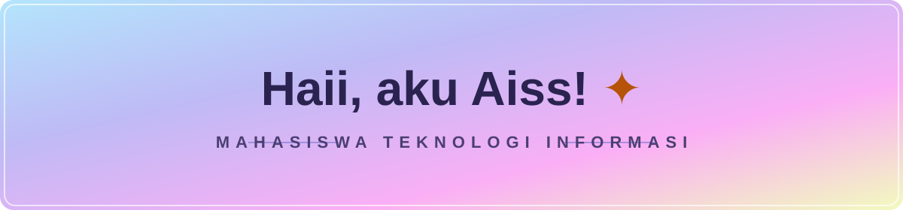
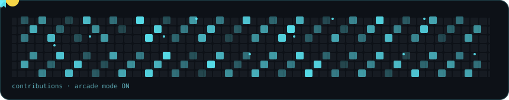
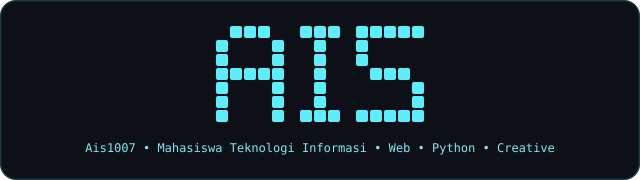

  <!-- ===== HERO PASTEL HEADER BANNER (SIMPLE) ===== -->
  

   

  <!-- ===== TYPING SVG ANIMATION ===== -->
  

   

  <!-- ===== PROFILE BADGES ===== -->
  
  
  

 

  <!-- ===== CYAN NAME ART (#5DEEFC) ===== -->
  
<i>Senang kalau kamu mau menyapa 💙</i>

  
  &nbsp;
  
  &nbsp;
  

    

  <!-- ===== ARCADE CONTRIBUTION GRAPH ===== -->
  

   

  

 

---

## Tentang Saya
<table width="100%">
  <tr>
    <td width="34%" align="center" valign="middle">
      
        
      <b>Aiss (Ais Syahrizta Aira)</b> 
      💻 <i>Mahasiswa Teknologi Informasi</i> 
      ✨ <i>pencari hal-hal seru 🤭</i>
    </td>
    <td width="66%" valign="top">
      <h3>Kenalan dengan Aiss</h3>
      

        Halo semuanya! Kenalin aku <b>Aiss</b> (username: <b>@Ais1007</b>) 🩵 
        Aku mahasiswa Teknologi Informasi yang suka mengeksplorasi teknologi, belajar hal baru, dan membuat proyek kreatif.
      

      <ul>
        <li>🎓 Mahasiswa Teknologi Informasi</li>
        <li>💡 Tertarik pada pemrograman dan pengembangan web</li>
        <li>🎨 Senang mencoba ide dan proyek baru</li>
      </ul>
    </td>
  </tr>
</table>

## Tech Stack & Tools
Bahasa pemrograman dan tools yang sedang dipelajari:

  

## Statistik GitHub

  
  

    

  <!-- ===== STREAK STATS CARD (CREAM & ORANGE) ===== -->
  

## Sedang Dipelajari
| Materi | Target Berikutnya | Tujuan |
| :--- | :--- | :--- |
| 📘 Dasar Web (HTML, CSS, JavaScript) | ⚛️ React / Next.js | 💡 Membuat proyek web bermanfaat |
| 🐍 Python &amp; problem solving | 🧠 Algoritma dan struktur data | 🏆 Menyelesaikan studi dengan baik |
| 🐙 Git &amp; GitHub | 🎨 UI/UX di Figma | 💼 Siap berkolaborasi dalam proyek |

> 🤭 "Selalu ada hal baru dan seru untuk dipelajari. Setiap error adalah kesempatan untuk mencoba cara lain."

## Yuk Terhubung

  
Terbuka untuk diskusi dan kolaborasi seputar teknologi.

  
  

   
  
  Terima kasih sudah berkunjung! 🌌

