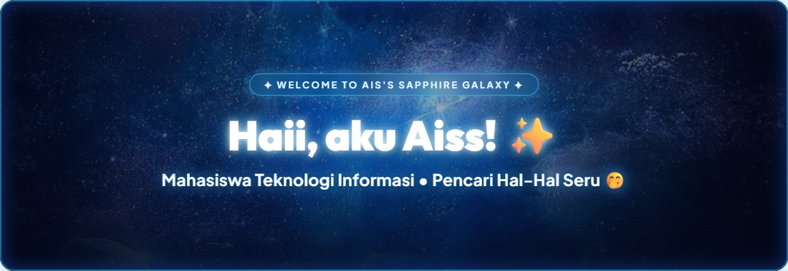
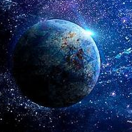

<div align="center">

  <!-- ===== HERO SAPPHIRE GALAXY HEADER BANNER ===== -->
  

  <br/><br/>

  <!-- ===== TYPING SVG ANIMATION ===== -->
  <a href="https://github.com/Ais1007">
    
  </a>

  <br/><br/>

  <!-- ===== QUICK BADGES (Sapphire Cosmic Palette) ===== -->
  
  
  
  <a href="https://github.com/Ais1007">
    
  </a>

</div>

<br/>

<!-- ===== GRADIENT SAPPHIRE DIVIDER ===== -->
<div align="center">
  
</div>

<br/>

<!-- ===== TENTANG SAYA (TEMA CODINGAN) ===== -->
<table width="100%">
  <tr>
    <td width="34%" align="center" valign="middle">
      <br/>
      <p align="center">
        <b>꒰ 🌌 𝑎𝑏𝑜𝑢𝑡 𝑚𝑒 🌌 ꒱</b>
      </p>
      
      <br/><br/>
      <b>Aiss (Ais Syahrizta Aira)</b><br/>
      <sub>💻 <i>Mahasiswa Teknologi Informasi</i></sub><br/>
      <sub>✨ <i>pencari hal-hal seru 🤭</i></sub>
      <br/><br/>
      <a href="https://github.com/Ais1007">
        
      </a>
      <a href="mailto:aissyahriztaaira@gmail.com">
        
      </a>
      <br/><br/>
    </td>
    <td width="66%" valign="top">
      <h3>🚀 ⋆｡° Kenalan dengan Aiss</h3>
      <p>
        Halo semuanya! Kenalin aku <b>Aiss</b> (username: <b>@Ais1007</b>) 🩵<br/>
        Saat ini aku adalah seorang <b>Mahasiswa Teknologi Informasi</b> yang suka banget eksplor dunia teknologi dan pemrograman.
      </p>
      <p>
        Deskripsi singkat tentang diriku? Aku adalah <b>pencari hal-hal seru 🤭</b> — selalu penasaran sama ide-ide baru, suka ngulik sampai paham, dan paling bahagia kalau baris kode yang dirangkai berhasil running mulus tanpa error! ✨
      </p>
      <ul>
        <li>🎓 <b>Peran:</b> Mahasiswa Teknologi Informasi</li>
        <li>💡 <b>Jiwa Penasaran:</b> Senang menemukan hal seru dan tantangan baru</li>
        <li>🎨 <b>Sapphire Palette:</b> <code style="color:#38bdf8;">#38bdf8</code> <i>(Electric Cyan)</i> • <code style="color:#2563eb;">#2563eb</code> <i>(Sapphire Blue)</i> • <code style="color:#e0f2fe;">#e0f2fe</code> <i>(Starlight Ice)</i> • <code style="color:#060d1f;">#060d1f</code> <i>(Deep Void)</i></li>
        <li>☕ <b>Bahan Bakar:</b> Kopi dingin, playlist lagu asik, dan laptop siap ngoding</li>
        <li>💬 <b>Suka Ngobrolin:</b> Coding, tech stack baru, tugas kuliah, &amp; proyek kreatif</li>
      </ul>
    </td>
  </tr>
</table>

<br/>

<!-- ===== CODE CARD: TENTANG SAYA TEMA CODINGAN ===== -->
<div align="left">
  <sub><b>📁 src/aiss_profile.ts</b> &nbsp;|&nbsp; 🔴 🟡 🟢</sub>
</div>

```typescript
/**
 * ============================================================================
 * 🧑‍💻 Biodata Diri: Aiss
 * 🎓 Major : Mahasiswa Teknologi Informasi
 * 🎯 Vibe  : Pencari hal-hal seru 🤭
 * 🌌 Theme : Sapphire Cosmic Nebula (#060d1f • #2563eb • #0284c7 • #38bdf8)
 * ============================================================================
 */

interface Profile {
  namaPanggilan : string;
  githubUser    : string;
  status        : string;
  deskripsiDiri : string;
  colorPalette  : { deepVoid: string; sapphireNebula: string; electricCyan: string; starlight: string };
  hobi          : string[];
  fokusBelajar  : string[];
  mottoHidup    : () => string;
}

const aiss: Profile = {
  namaPanggilan : "Aiss",
  githubUser    : "Ais1007",
  status        : "Mahasiswa Teknologi Informasi 🎓💻",
  deskripsiDiri : "pencari hal-hal seru 🤭",
  colorPalette  : {
    deepVoid       : "#060d1f", // Kehampaan angkasa biru malam 🌌
    sapphireNebula : "#2563eb", // Pijar nebula safir kosmik 💎
    electricCyan   : "#38bdf8", // Kilau debu bintang cyan 🩵
    starlight      : "#e0f2fe"  // Cahaya bintang kristal ⭐
  },
  hobi : [
    "Eksplorasi kode & teknologi baru 🚀",
    "Bikin tampilan visual estetik 🎨",
    "Dengerin musik sambil ngulik solusi 🎧",
    "Mencari pengalaman seru bareng teman ☕"
  ],
  fokusBelajar : [
    "Algoritma & Struktur Data",
    "Web Development (HTML, CSS, Modern JavaScript)",
    "Dasar Pemrograman Python & Git Workflow"
  ],
  mottoHidup : () => {
    return "Selalu ada hal seru di balik setiap tantangan baru! 🤭✨";
  }
};

console.log(`Halo Dunia! Aku ${aiss.namaPanggilan}, ${aiss.deskripsiDiri}`);
```

<br/>

<!-- ===== TECH STACK & TOOLS ===== -->
<div align="center">

  

  <p>Bahasa pemrograman, software, dan teknologi yang sedang &amp; sering dipelajari:</p>

  <!-- Skill Icons Dark Mode Friendly -->
  <a href="https://skillicons.dev">
    
  </a>

  <br/><br/>

  <!-- Sapphire Palette Badges -->
  
  
  
  
  
  
  
  

</div>

<br/><br/>

<!-- ===== GITHUB STATS & ACTIVITY (SAPPHIRE COSMIC THEME) ===== -->
<div align="center">

  

  <br/><br/>

  <!-- GitHub Readme Stats Card (Theme: Deep Space #060D1F with Sapphire Blue & Cyan Accents) -->
  
  <!-- Top Languages Card -->
  

  <br/><br/>

  <!-- Streak Stats Card -->
  

  <br/><br/>

  <!-- Contribution Chart (Sapphire Cyan Accent) -->
  <p><b>📊 Grafik Kontribusi GitHub @Ais1007</b></p>
  <a href="https://github.com/Ais1007">
    
  </a>

  <br/><br/>

  <!-- Activity Graph (Sapphire Colors: Line #0284C7, Point #BAE6FD, Border #1D4ED8) -->
  

</div>

<br/>

<!-- ===== LEARNING ROADMAP ===== -->
<div align="center">
  
</div>

| 🌌 Sedang Dipelajari | 🚀 Target Seru Selanjutnya | 🪐 Impian &amp; Target |
| :--- | :--- | :--- |
| 📘 Dasar Web (HTML, CSS, JS Modern) | ⚛️ Frontend Framework (React / Next.js) | 💡 Bikin project web interaktif &amp; bermanfaat |
| 🐍 Logika &amp; Problem Solving Python | 🧠 Algoritma &amp; Struktur Data Lanjutan | 🏆 Menyelesaikan studi TI dengan prestasi memuaskan |
| 🐙 Kolaborasi Git &amp; GitHub Workflow | 🎨 UI/UX Design Interaktif di Figma | 💼 Siap magang &amp; kolaborasi proyek open-source |

<br/>

<!-- ===== CATATAN SERU & SAPPHIRE EXOPLANET CARD ===== -->
<table width="100%">
  <tr>
    <td width="30%" align="center" valign="middle">
      
    </td>
    <td width="70%" valign="middle">
      <h3>🪐 ⋆｡° Catatan Seru &amp; Filosofi Kosmik Aiss</h3>
      <blockquote>
        <p>
          🤭 <i>"Dunia teknologi itu luas banget, selalu ada hal baru dan seru buat dieksplor tiap harinya. Jangan takut salah pas ngoding, karena setiap error cuma cara komputer bilang: 'ayo coba cara yang lebih seru!' ✨"</i>
        </p>
      </blockquote>
      <p><sub>🚀 <i>Menjelajah baris kode, menembus batas rasa ingin tahu.</i></sub></p>
    </td>
  </tr>
</table>

<br/>

<!-- ===== KONTAK & SOSIAL MEDIA ===== -->
<div align="center">

  

  <p>Pintu selalu terbuka untuk diskusi santai seputar IT, kolaborasi proyek seru, atau sekadar bertukar sapa!</p>

  <a href="mailto:aissyahriztaaira@gmail.com" target="_blank">
    
  </a>
  &nbsp;
  <a href="https://github.com/Ais1007" target="_blank">
    
  </a>

</div>

<br/><br/>

<!-- ===== FOOTER (Sapphire Cosmic Waving Banner) ===== -->
<div align="center">

  

  <br/>

  <p>
    <b>Terima kasih sudah menjelajah ke profil Aiss! 🌌✨ Semoga harimu secerah bintang di angkasa!</b><br/>
    <sub>Dibuat dengan rasa penasaran tinggi &amp; cinta pada dunia ngoding ✨</sub>
  </p>

  
  &nbsp;
  

</div>
